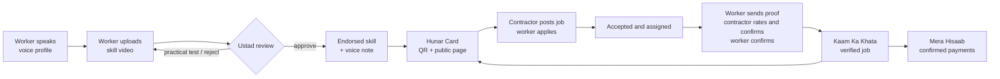
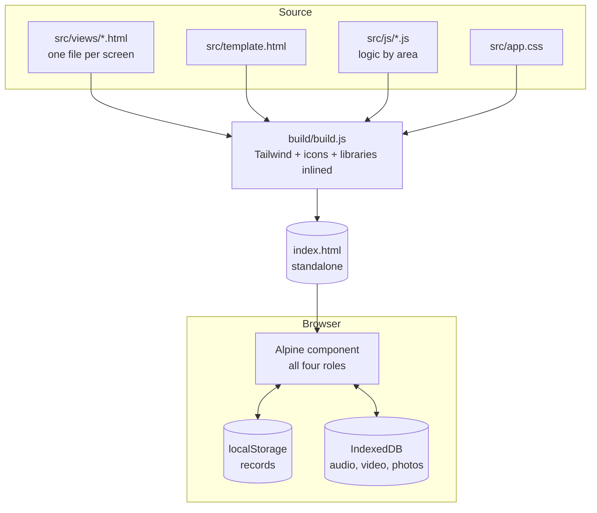

<div align="center">

# HunarSetu

### Your Skills. Your Reputation. Your Livelihood.

A voice-first prototype that gives skilled informal workers a portable, human-verified record of what they can do and the work they have done.

*Build for Bharat, Track 6: Education, Skills and Employment*


</div>

---

## Contents
- [Submission links](#submission-links)
- [Introduction](#introduction)
- [The problem](#the-problem)
- [Our solution](#our-solution)
- [Roles](#roles)
- [Worker journey](#worker-journey)
- [Features](#features)
- [Screenshots](#screenshots)
- [Demo](#demo)
- [Technology](#technology)
- [Architecture](#architecture)
- [Project structure](#project-structure)
- [Getting started](#getting-started)
- [Deployment and QR links](#deployment-and-qr-links)
- [Testing](#testing)
- [Privacy and data](#privacy-and-data)
- [Limitations](#limitations)
- [Future improvements](#future-improvements)
- [Contributing](#contributing)
- [Documentation](#documentation)

## Submission links

| Item | Link |
|---|---|
| Problem brief | [docs/problem-brief.md](docs/problem-brief.md) |
| GitHub repository | https://github.com/kirtisharma-sudo/hunarsetu |
| Live demo | https://kirtisharma-sudo.github.io/hunarsetu/ |
| Demo video | https://drive.google.com/file/d/1UB8kRK9wP8RiSVYZin7pEF-3gI8oEwuJ/view?usp=sharing |
| Explanation of value | [Our solution](#our-solution) and [docs/problem-brief.md](docs/problem-brief.md) |

## Introduction

HunarSetu ("hunar" means skill, "setu" means bridge) connects four things that informal workers usually have to prove separately: **skills, trust, employment and work history**. A worker introduces themselves by voice, shows a skill on a short video, and has it reviewed by an experienced technician (an Ustad). The result is a Hunar Card with a QR code that opens a public verification page, and a work history that only counts once both sides have confirmed it.

The pilot scenario is electricians, plumbers and appliance repair technicians in Delhi-NCR. This is a working front-end prototype, not a production service (see [Limitations](#limitations)).

## The problem

Many skilled workers in India's informal economy have years of practical experience but no certificate, no written resume and no record of past jobs. Work usually comes through word of mouth, and a worker's reputation stays with the contractor who knew them. Typical job portals assume a typed, English-language profile, and a video on its own does not tell a hirer whether anyone trustworthy has checked the skill.

## Our solution

| Common gap | How HunarSetu responds |
|---|---|
| Cannot write a resume | Profile is built from a spoken introduction in Hindi or English, editable before saving |
| No proof of skill | Skill video reviewed by a named human Ustad, who endorses, asks for a practical test, or declines |
| Automated checks mistaken for approval | On-device video checks are shown as hints only and never create verification |
| Reputation is not portable | Hunar Card with QR and a public page that never shows the phone number |
| Self-reported job history | A job is verified only after **both** contractor and worker confirm it |
| Payment disputes | Both sides confirm each recorded amount, advance and payment |
| Cannot use a smartphone app alone | A Hunar Mitra can help, with the worker's explicit consent |

What makes it different is the separation of **machine hints** from **human verification**, and the rule that records become verified only through confirmation by the other party.

## Roles

| Role | Who | What they do in the app |
|---|---|---|
| **Worker** | Electrician, plumber, appliance technician | Voice profile, skill test, Find Work, Hunar Card, Kaam Ka Khata (work history), Mera Hisaab (payments), Help with Hindi voice guides |
| **Ustad** | Experienced master technician who verifies skills | Reviews skill videos, records a voice endorsement, approves, requests a practical test or rejects, handles mentorship requests |
| **Contractor** | Person or firm that hires | Posts jobs, searches workers with a visible points score, handles applications, assigns work, confirms completion, records payments |
| **Hunar Mitra** | Local support representative | Registers workers with consent, helps with voice and video, answers help requests, books practical tests, posts community announcements. Has no administrator powers |

## Worker journey

**Skills → Trust → Employment → Work History → Reputation**



1. **Skills.** Ramesh Kumar records a short introduction. The app keeps the real audio and offers the extracted details (name, years, trade, skills) for editing. If the browser cannot transcribe, nothing is invented: he types the text, or uses a clearly labelled sample.
2. **Trust.** He records a skill video. Basic on-device checks (length, picture size, light, camera steadiness) are shown as hints. Ustad Suresh Sharma watches it and endorses it with a comment or a voice note. The level shown is "Ustad reviewed", or "Practically assessed" only after an in-person test.
3. **Employment.** Contractor Amit Verma posts a job. Ramesh sees it ranked by trade, distance and experience, applies, and is accepted and assigned.
4. **Work history.** Ramesh sends photos and a note. Amit rates the work and confirms. Ramesh confirms. Only then does the job appear as verified in Kaam Ka Khata.
5. **Reputation.** The Hunar Card shows endorsements and confirmed jobs. Anyone can scan the QR to open the public page, which excludes private details.

## Features

| Area | What is implemented |
|---|---|
| Voice onboarding | Real microphone recording (MediaRecorder), playback, optional browser speech recognition, editable extracted fields, Hindi and English |
| Skill assessment | Video upload or recording, on-device quality hints, clear "not a safety certificate" notice |
| Ustad review | Pending queue, video playback, voice or written endorsement, approve / practical reassessment / reject |
| Hunar Card | Real scannable QR, share, copy and open actions, public verification page without login |
| Jobs | Posting with validation, match scoring, applications, duplicate-apply guard, accept and assign |
| Kaam Ka Khata | Work records with proof photos, mutual confirmation, contractor rating |
| Mera Hisaab | Agreed amount, advances and payments, both-side confirmation, overpayment flag, disputes excluded from totals |
| Contractor search | Filters by trade, skill, location radius, experience, availability, verification |
| Hunar Mitra | Consent-gated assisted registration, help requests, appointments, community notices |
| Demo support | Role switcher, 9-step guided journey, sample data labelled Sample, data export, reset |
| Responsive UI | Bottom navigation on mobile and tablet, sidebar layout on desktop |

## Screenshots

Screenshots have not been added yet. Capture them from the running app and place them in `docs/screenshots/`.

| Screen | Prototype |
|---|---|
| Voice-Based Worker Onboarding (Hindi) |  |
| Hunar Card with QR ||
| Ustad review |  |
| Contractor Find Workers | |

## Demo

- **Live demo:** https://kirtisharma-sudo.github.io/hunarsetu/
- **Demo video:** https://drive.google.com/file/d/1UB8kRK9wP8RiSVYZin7pEF-3gI8oEwuJ/view?usp=sharing **
- **Run locally:** open `index.html` in Chrome, then follow [docs/demo-script.md](docs/demo-script.md). The in-app Demo guide (sliders button, top right) lists the same nine steps and jumps to the right role.

## Technology

| Layer | Choice |
|---|---|
| Markup and logic | HTML and JavaScript, Alpine.js 3.14.1 |
| Styling | Tailwind CSS 3.4.17, compiled at build time to only the classes used |
| Icons | Font Awesome Free 6.5.2 (used icons only, fonts embedded) |
| QR code | `qrcode-generator` 1.4.4, inlined |
| Browser APIs | MediaRecorder, IndexedDB, localStorage, Web Speech API (optional, if available) |
| Build | A single Node script, `build/build.js` |
| Tests | `puppeteer-core` with headless Chrome, `jsqr` and `pngjs` to decode the QR |

There is no framework build chain, no backend and no external API call at run time. The output is one standalone `index.html` of roughly 780 KB.

## Architecture



- One Alpine component serves all four roles and reads and writes a single shared JSON database in `localStorage`. Audio, video and photos are stored as blobs in IndexedDB and referenced by id.
- Rules live in code: screening never approves a skill, a record is `completed` only after both confirmations, and payment entries need the other party's confirmation.
- The public QR page works without a server because the link carries a compact snapshot of the card (name, trade, location, years, skills, up to two endorsements, job count). The snapshot never contains a phone number.

Details: [docs/architecture.md](docs/architecture.md).

## Project structure

```text
hunarsetu/
├── index.html              Generated standalone app (committed so it can be opened or hosted directly)
├── prototype-v1.html       First single-role prototype, kept for reference
├── package.json            Build and test scripts
├── build/build.js          Bundles src/ into index.html
├── src/
│   ├── template.html       Page shell
│   ├── app.css             Tailwind entry and component styles
│   ├── js/                 00-util, 10-data, 20-core, 30-worker, 40-roles, 50-hi, 90-main
│   └── views/              One HTML file per screen (w_ worker, u_ ustad, c_ contractor, m_ mitra, p_ shared)
├── tests/
│   ├── smoke.js            Opens every navigation screen of every role
│   ├── journey.js          Full end-to-end journey, 59 checks
│   └── sample.mp4          Small video fixture used by the journey test
└── docs/                   Problem brief, architecture, demo script
```

## Getting started

**Just run it.** Open `index.html` in Chrome (desktop or Android). Nothing to install. Allow the microphone when asked.

**Rebuild from source** (Node.js 18 or newer):

```bash
npm install
npm run build        # regenerates index.html
```

The build script reads `node_modules` from the project folder, or from the path in the `HS_NODE_MODULES` environment variable.

## Deployment and QR links

The app is one static file, so any static host works.

- **GitHub Pages:** Settings, Pages, deploy from branch `main`, root folder.

QR codes encode `<base address>#/v/<id>?d=<snapshot>`. When the app is opened from its deployed HTTPS address, that address is used automatically. If you open it from a file or another address, enter the full HTTPS address in **Demo guide, Optional services, Public link base**; values that do not start with http:// or https:// are ignored.

Scanning a QR on a different phone requires the deployed HTTPS URL. The snapshot in the link shows the card as it was when generated, not live updates.

## Testing

Tests drive the real `index.html` in headless Chrome with a fake microphone and camera.

```bash
npm install
npm run test:smoke     # every screen of every role, reports console errors
npm test               # full journey, 59 checks
```

Chrome must be installed. Set `CHROME_PATH` if it is not at `/usr/bin/google-chrome`. Set `VIEWPORT_W` (for example `1366`) to run at another width; the default is 390.

**What the journey test covers**

| Area | Checks include |
|---|---|
| Voice and onboarding | Recording starts and a real audio blob is captured; no fake transcript when speech-to-text is unavailable; sample text is labelled; field extraction; validation |
| Skill verification | Video analysed on device; screening labelled as demo; not verified before Ustad review; approval blocked without comment or voice; level is "Ustad reviewed", not practical |
| QR and public page | Real QR generated and decoded back to the card URL; public page opens without login; phone number hidden |
| Jobs | Posting validation, ranking, apply, duplicate-apply guard, acceptance, assignment |
| Work history | Unconfirmed jobs excluded; proof note required; rating required; verified only after both confirm |
| Payments | Amount validation, totals, both-side confirmation, overpayment flag, disputed entries excluded |
| Hunar Mitra | Consent required; can act only for workers she registered; help requests; appointments |
| Search and storage | Filters and radius; data, session, audio and media survive reload; reset restores seed data |

The journey has passed at 390, 768, 1024 and 1366 pixel widths during development. Tests have been run locally against `index.html` only. They have not been run on a deployed URL, on real phones, or in browsers other than Chrome. They do not measure accessibility or performance.

## Privacy and data

- Everything is **browser-local**: records in `localStorage`, recordings, videos and photos in IndexedDB. Nothing is sent to any server.
- Phone numbers are optional, stay on the device, and are never placed in QR links or on the public page.
- Seeded people and records are labelled **Sample** and are not real.
- "Download data" in the Demo guide exports records as JSON (media stays on the device). "Reset demo" erases this browser's data.

## Limitations

- **Data is stored locally in the browser.** There is no shared cloud database, so another phone or browser sees only its own data plus whatever a QR link carries.
- **There is no production authentication.** Role switching is a demo mechanism, not secure role-based access. Choosing "Ustad" does not make anyone a verified Ustad.
- **Speech-to-text and vision screening integrations are optional and not connected.** The settings accept endpoint URLs but they have not been tested against any real service. Without them the app uses browser speech recognition where available, otherwise typed or sample text.
- **Video checks are not safety certification.** They only measure length, picture size, light and camera steadiness. Verification means a person reviewed the skill.
- **Ustad verification is human-led.** The app records the Ustad's decision; it cannot prove who that person is.
- **The payment ledger records agreements and confirmations.** It does not hold money, guarantee payment or provide escrow.
- **Cross-device QR verification needs a deployed HTTPS URL**, and has not yet been tested on one.
- Hindi coverage is mainly on worker-facing screens; other roles are mostly English.
- Distances use approximate locality centres in Delhi-NCR, not exact addresses.
- Not tested on real phones or low-end devices. No field research or measured impact is claimed.

## Future improvements

These are ideas, not implemented or promised features:

- A shared backend with real authentication and role-based access
- Verified identity for Ustads
- Connecting a real speech-to-text service and a vision screening service
- Live (not snapshot) public profiles
- More Hindi and other regional language coverage across all roles
- Field testing with real workers, contractors and Ustads
- Payment integrations designed with proper dispute handling

## Contributing

Issues and pull requests are welcome.

1. Edit files under `src/`, never `index.html` directly.
2. Run `npm run build` and commit the regenerated `index.html` with your change.
3. Run `npm run test:smoke` and `npm test` and make sure both pass.
4. Keep claims honest: do not describe a feature as verified, secure or integrated unless the code does it.
5. Do not commit secrets, `.env` files or real personal data.

## Documentation

[Problem brief](docs/problem-brief.md) | [Architecture](docs/architecture.md) | [Demo script](docs/demo-script.md)
