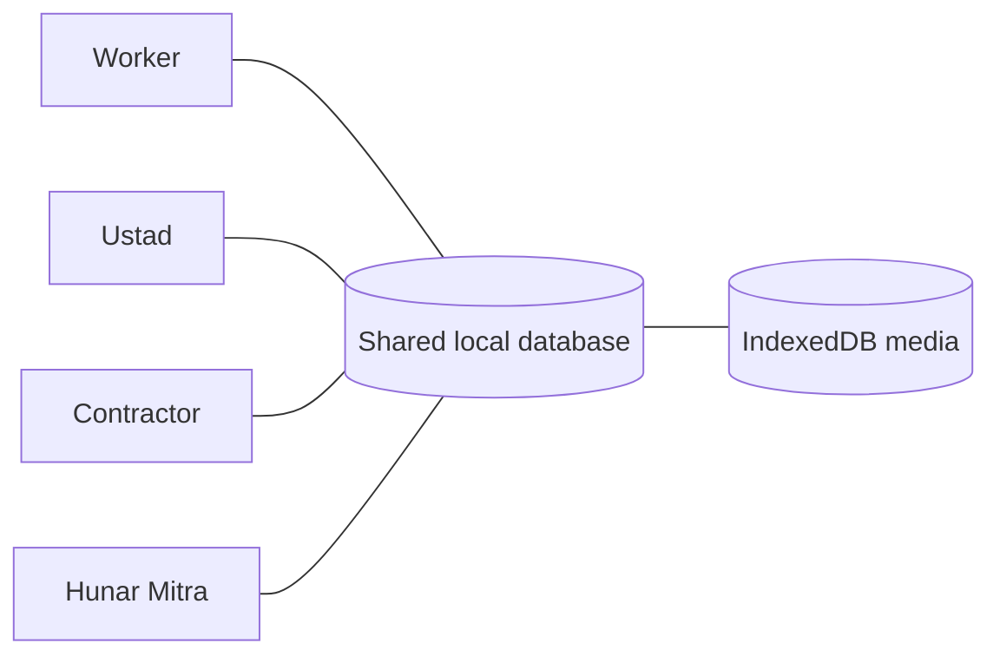

# Architecture

HunarSetu is a static, front-end-only application. The build produces a single `index.html` containing compiled CSS, Alpine.js, the QR library, icons and all app code. There is no server, no backend and no external request at run time. See the [README](../README.md) for setup.

## Build
`build/build.js` (run with `npm run build`):
1. Assembles `src/template.html` with the screens in `src/views/` (Hindi text is stored as `\uXXXX` escapes and decoded here).
2. Concatenates `src/js/*.js` in file-name order.
3. Compiles Tailwind CSS for only the classes used.
4. Embeds only the Font Awesome icons used, with fonts as base64.
5. Inlines `qrcode-generator` and Alpine.js and writes `index.html`.

## Source layout
| Path | Responsibility |
|---|---|
| `src/js/00-util.js` | Ids and dates, IndexedDB media store, audio recorder, optional browser speech recognition, video quality analysis, QR helper, field extraction |
| `src/js/10-data.js` | Trades, skills, FAQ, Hindi help text, seed data (flagged Sample) |
| `src/js/20-core.js` | State, persistence, navigation, lookups, matching, public snapshot and QR URL |
| `src/js/30-worker.js` | Onboarding, profile, skill test, applications, work records, payments |
| `src/js/40-roles.js` | Ustad review, contractor hiring, Hunar Mitra support, demo guide, reset |
| `src/js/50-hi.js` | Hindi labels for worker-facing screens |
| `src/js/90-main.js` | Merges the parts into one Alpine component |
| `src/views/*.html` | One file per screen: `w_` worker, `u_` ustad, `c_` contractor, `m_` mitra, `p_` shared partials |
| `src/app.css` | Tailwind entry, component classes, responsive layout rules |

## Data model
`localStorage` holds one JSON database (`hunarsetu.db.v1`) with: workers, ustads, contractors, hunar_mitras, skill_assessments, endorsements, jobs, job_applications, work_records, payment_records, support_requests, mentorships, community, events. Session and settings use separate keys. Audio, video and photos are blobs in the IndexedDB database `hunarsetu-media`, referenced by id. All four roles read and write the same database.

## Rules enforced in code
- Endorsements come only from an Ustad's explicit decision; screening never approves a skill. Approval needs a comment or a voice note.
- A work record becomes `completed` only after contractor and worker both confirm.
- A payment entry needs confirmation from the other party; disputed entries are excluded from totals and overpayment is flagged.
- A Hunar Mitra can register a worker only with consent and can act only for workers she registered.
- The public QR page uses a compact snapshot inside the URL (name, trade, location, years, skills, up to two endorsements, job count and rating). It never includes a phone number.

## Navigation and layout
Navigation is two-phase (blank, then switch) so a screen never reads data that was just removed. Each detail screen captures its record once. Layout is mobile-first: bottom navigation on mobile and tablet, a left sidebar from 1024px.

## Optional integrations (not connected)
Settings accept a speech-to-text endpoint and a vision endpoint. They are untested against any real service. The app is fully usable without them.

## Not present
Authentication, a cloud database, multi-device sync and server-side validation. Moving to a backend would replace the localStorage and IndexedDB layer and add real login and role checks.
